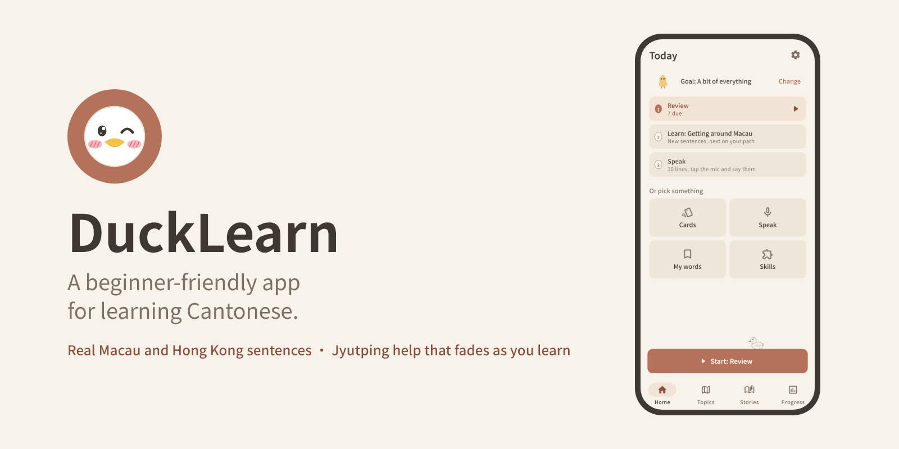

# DuckLearn

A free, beginner-friendly Cantonese app for Macau and Hong Kong. It has two modes, picked by one question when you first open it.

**New to Cantonese? Newcomer mode** teaches the essential words to get your point across, situation by situation:

- **40 situations:** ordering food, cha chaan teng, taxis, getting around, paying, finding a flat, the doctor, kids and school, settling in, allergies and diet, emergencies, and more.
- **A short daily drill:** see the English, say it in Cantonese, then hear it. Key words are enough; you don't need perfect sentences.
- **"What do you want to say?"** search on Home, for the word you need right now.
- **Train your ear:** understand what people say back, and hear the six tones apart.
- **Build a sentence** from simple frames, plus a Jyutping guide and the little particles.
- **Real-world challenges:** one small thing to try for real ("say 早晨 to a neighbor").
- **Pictures** for most words: photos for things, icons for ideas.

**Speak Cantonese but can't read it? The reading app** teaches reading with real Macau and Hong Kong sentences. Read each one first, then Check to hear it and mark anything you got wrong. Jyutping sits above each character and fades as you learn it.

- **Today's plan:** review, learn the next topic for your goal, then speak. One Start button.
- **Topics, stories and conversations** to read whole texts.
- **Flashcards** for dishes, streets and stations.
- **Saved words** that you practice in the sentence they came from, and a reader for any text you share into the app.
- **How much everyday Cantonese you can read**, measured against recorded Hong Kong conversation.

Both modes share all the content. The read-aloud check runs on your phone; nothing you say leaves it. There are no streaks and no quotas: go at your own pace. Sharing anonymous usage data is opt-in.

## Install

Android (arm64) builds are on the [Releases](../../releases) page. Download `DuckLearn-android-arm64.apk` and open it; you may need to allow installs from your browser. The app checks for updates when it starts and offers to install them.

## For developers

- [Design spec](docs/DESIGN.md)
- [Roadmap](docs/ROADMAP.md): what's next, and open launch items (3.7)
- [Changelog](docs/CHANGELOG.md)
- [Content guide](docs/CONTENT_GUIDE.md): YAML formats for situations, practice, sentences, decks
- [Event schema](docs/EVENTS_SCHEMA.md)
- [Data sources](docs/DATA_SOURCES.md) and their licences
- [Usage data and privacy](docs/TELEMETRY.md): opt-in, anonymous

```
content/    YAML: situations, practice, scenarios, dialogues, stories, decks, pictures
pipeline/   Python (`duk`): fetch, annotate, validate, TTS, build content.db, bundle
app/        Flutter app (engine/ and events/ are pure Dart and unit-tested)
worker/     Cloudflare Worker for opt-in usage data and crash reports
tool/       release.sh
docs/
```

Content is drafted with an LLM and readings come from open dictionaries (CC-CEDICT, CC-Canto, rime-cantonese, Unihan, HKCanCor). Credits are in the app under Settings → About.
